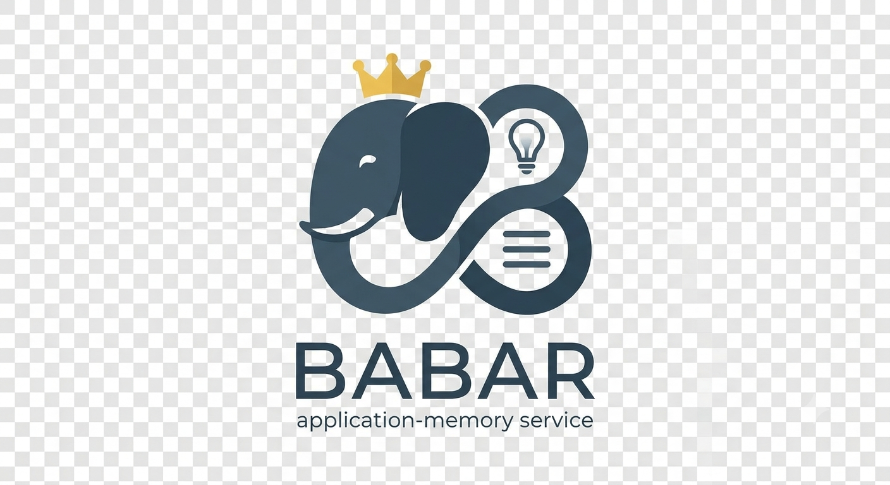

# Babar

Babar is an independent, local application-memory tool implementing the **MEMORA**
pattern. It stores sourced notes, retrieves relevant context, and preserves explicit
revisions across conversations and application restarts. Any local application or
MCP host can consume it through **MCP over stdio**, using a fixed namespace.
The Python distribution is named `babar`; its implementation package is `memora`.

For example, Abacus Budget advisor can remember an approved intention to reduce
spending and recall it during a later savings discussion. A writing assistant,
project planner, or developer tool can use the same service with its own notes,
namespace, and authorization policy. Abacus is one consumer, not a prerequisite.

## Boundaries and responsibilities

| Component | Owns |
| --- | --- |
| Babar | Note validation, namespace-scoped retrieval, offline embeddings, provenance, revisions, idempotency, and atomic persistence |
| Consumer / MCP host | Starting and stopping the MCP child, application workflow, write authorization, context budgets, and interpretation of recalled notes |
| Operator | Python environment, PostgreSQL with pgvector, offline model cache, private runtime profiles, migrations, and backups |

Babar runs as a local stdio process. Its database is separate from the consumer's
application data. It requires neither a particular application repository nor a
workflow engine, generative-model server, container platform, or HTTP service.
PostgreSQL and the model cache must be prepared separately; starting Babar does
not provision them. Operator-configured PostgreSQL endpoints support explicit libpq TLS settings.

Applications authorize mutations through user approval or a configured workflow
policy. The core validates storage operations but does not enforce application
approval or evidence policies. Recalled notes are untrusted context, not executable
instructions. Babar does not run generative models or execute instructions in notes.
MCP itself is not an OS sandbox: the process runs with its OS user's access.

An optional deterministic dreaming controller supports proposal evaluation and
explicit consolidation. Consumers supply scheduling, model adapters, and
authorization; Babar supplies no general automation runner. See
[optional dreaming](https://github.com/jbromfld/babar/blob/master/docs/DREAMING.md)
and [orchestration notes](https://github.com/jbromfld/babar/blob/master/docs/AUTOMATION.md).

## How memory works

```text
Consumer requests relevant context
  → local pinned embeddings + text/topic-cue matching
  → namespace-scoped PostgreSQL/pgvector search
  → bounded source notes returned to the consumer

Consumer authorizes a memory write
  → explicit create or revision-checked update
  → note + provenance + revision committed atomically
```

Similarity helps retrieval and duplicate suggestions. It never merges records by
itself: consolidation requires an explicit, revision-checked operation authorized
by the consumer.

The MEMORA record consists of:

| Field | Purpose |
| --- | --- |
| `primary_abstraction` | Concise concept/title |
| `primary_embedding` | Local vector for semantic retrieval |
| `memory_value` | JSONB note, application-defined type, source date, and approved source excerpt |
| `cue_anchors` | Topic tags for matching/filtering |

Records also have a namespace, UUID, idempotent creation key, revision,
active/completed/abandoned status, and timestamps. Revisions retain provenance.
Completed/abandoned records remain inspectable but are excluded from recall.
Forgetting deletes the record, embedding, source excerpts, and history; independently
retained backups have their own retention lifecycle.

## Install and prepare

### 1. Install the Python package

Use the repository's pinned CPython **3.13.16** and `uv`. The current lockfile targets
macOS ARM64 and Linux ARM64; Linux uses pinned CPU PyTorch wheels.

```sh
git clone https://github.com/jbromfld/babar.git
cd babar
uv sync --locked --extra dev
```

Run subsequent `uv` commands from this checkout. This installs Babar in an editable
`.venv` along with runtime and development dependencies. For runtime-only use,
omit `--extra dev`. Dependencies are defined by
[pyproject.toml](https://github.com/jbromfld/babar/blob/master/pyproject.toml) and
[uv.lock](https://github.com/jbromfld/babar/blob/master/uv.lock).

### 2. Prepare the offline embedding model

Before starting a consumer, explicitly acquire this exact model snapshot:

- Model: `sentence-transformers/all-MiniLM-L6-v2`
- Revision: `c9745ed1d9f207416be6d2e6f8de32d1f16199bf`
- Embedding dimension: **384**

For example, on a network-connected machine, download it to the Hugging Face cache
used by the eventual runtime OS user:

```sh
uv run --no-sync python - <<'PYMODEL'
from huggingface_hub import snapshot_download

snapshot_download(
    repo_id="sentence-transformers/all-MiniLM-L6-v2",
    revision="c9745ed1d9f207416be6d2e6f8de32d1f16199bf",
)
PYMODEL
```

This is an explicit preparation step. Runtime never downloads weights, uses cloud
embeddings, or enables remote tracing. If using a custom cache, set the same
`HF_HOME` during preparation and in the MCP child's environment. An isolated
runtime needs a readable copy of that cache.

### Container consumers and remote databases

A consumer can package Babar from a full pinned commit and `uv.lock` in a separate
Linux Python environment, then launch it over stdio in the same container. Record
that source revision in the consumer release. Babar does not need its own Service
or Deployment. Updates require rebuilding and promoting the consumer image.

Mount the offline model cache read-only and explicitly pass `HF_HOME` to the child.
Run as a fixed non-root UID. A Kubernetes Secret mount alone does not satisfy
profile ownership checks: copy the profile into a memory-backed volume, chown it
to the runtime UID, and chmod it 0600. Recreate the pod after Secret rotation.

Runtime profiles accept `sslmode`, `sslrootcert`, `sslcert`, `sslkey`, and
`connect_timeout` (1–60 seconds, default 5). Non-loopback endpoints require an
explicit TLS mode. Use `verify-full` and a trusted CA for remote production
endpoints; an explicit `disable` is available for private local development.
Certificate paths refer to the runtime filesystem. No TLS downgrade is attempted.

Setup and reindex independently accept `PGHOST`, `PGPORT`, `PGUSER`, `PGPASSWORD`,
`PGSSLMODE`, `PGSSLROOTCERT`, `PGSSLCERT`, `PGSSLKEY`, and `PGCONNECT_TIMEOUT`.
Administrator settings never come from MCP arguments. For an existing database
and restricted login, provide an existing owner-only profile and run:

```sh
uv run --no-sync babar-setup --config /private/memory.json \
  --namespace project-planner --pre-provisioned
```

This maintains schema/grants and checks model identity and effective privileges
without creating a database/login or rotating its password. The administrator
must have schema/grant maintenance privileges. Cloud provider compatibility
requires testing against the actual provider; local TLS tests alone do not verify it.

### 3. Provision PostgreSQL and a runtime profile

Start a local PostgreSQL instance with pgvector installed on the database server.
Use your PostgreSQL installation's service commands; Babar does not manage the
database process. Supply administrator `PGHOST`, `PGPORT`, `PGUSER`, and `PGPASSWORD`
through a private environment; `PGDATABASE` optionally selects the bootstrap
database. See [.env.example](https://github.com/jbromfld/babar/blob/master/.env.example).
Babar does not implicitly load `.env` files.

Choose a private absolute path and an application namespace, then run:

```sh
uv run --no-sync babar-setup \
  --config /absolute/private/project-memory.json \
  --namespace project-planner
```

Setup creates the dedicated `babar_memory` database, versioned tables, and a
restricted managed `babar_memory` runtime login. Optional `--database` and `--user`
select another dedicated memory database/login. Generated runtime credentials are
saved in the owner-only JSON file with mode `0600`, never printed. Routine setup
preserves passwords. Use `--rotate-password` explicitly for managed-role recovery.
Keep runtime profiles outside version control.

The profile fixes database credentials, namespace, and model identity. Runtime
loads it only through `MEMORA_CONFIG`; administrator credentials are needed for
setup and maintenance, not normal memory operations.

## Consume Babar through MCP

Configure an MCP-capable application to launch Babar as a stdio child. A typical
host configuration looks like this; adapt the outer structure to your host:

```json
{
  "mcpServers": {
    "babar": {
      "command": "/absolute/path/to/babar/.venv/bin/babar-memory",
      "args": [],
      "env": {
        "MEMORA_CONFIG": "/absolute/private/project-memory.json",
        "HF_HUB_OFFLINE": "1",
        "TRANSFORMERS_OFFLINE": "1",
        "HF_HUB_DISABLE_TELEMETRY": "1"
      }
    }
  }
}
```

Replace the placeholder paths with absolute paths on the runtime machine. The
installed entry point works independently of the host's working directory.
Alternatively, use `/absolute/path/to/babar/.venv/bin/python` with arguments
`["-m", "memora.server"]`. Add `HF_HOME` if using a custom cache. Configure the host
to pass only the required OS/cache variables and `MEMORA_CONFIG`; an `env` block
may augment inherited variables, so check the host's environment handling. Do not
forward application, administrator, cloud, or search credentials to the child.

The host establishes the MCP session and invokes tools. Call `memory_status`
first to verify database/schema/model compatibility and offline model readiness.
Successful tool results use `{ok: true, data: ...}`; failures use
`{ok: false, code, message}`. Then retrieve context with `memory_search`, inspect
notes with `memory_list` / `memory_get`, and apply authorized writes explicitly.
Writes need a stable creation key or the inspected revision, depending on the
operation. See the [protocol guide](https://github.com/jbromfld/babar/blob/master/docs/MEMORA.md)
for note schemas, limits, idempotency, and errors.

For protocol testing, start the same process directly from the checkout:

```sh
MEMORA_CONFIG=/absolute/private/project-memory.json \
  uv run --no-sync babar-memory
```

This command waits for MCP messages on stdin. It is not a terminal chat interface;
stdout is reserved for the protocol. Normal use connects it to an MCP host.

### Application namespaces

Each runtime profile fixes exactly one namespace; tool callers cannot override it.
Every search, list, UUID lookup, update, and forget scopes that namespace. Profiles
are configured by the operator, not by model-generated arguments.

Trusted consumers may share a memory database/model identity with separate
namespaces and managed logins. For example:

```sh
uv run --no-sync babar-setup \
  --config /absolute/private/writing-memory.json \
  --namespace writing-assistant \
  --database babar_memory --user writing_memory
```

Namespace scoping is an application boundary inside a trusted local service, not
multi-user database authorization: runtime roles have access to memory tables.
For mutually untrusted consumers, use separate databases/logins and OS isolation.
All profiles sharing one database must use the same embedding identity.

Consumers define note kinds and approval flows. For example,
[Abacus](https://github.com/jbromfld/abacus/blob/master/docs/advisor-memory.md)
uses its own memory database/login, separate from its financial database, and
accepts intentions, preferences, and decisions with explicit user approval.
Other consumers can define their own kinds and policies.

## Start, stop, and restart

| Action | Procedure |
| --- | --- |
| Start | Ensure PostgreSQL is running and the model cache/profile are available, then enable/connect Babar in the MCP host. The host spawns the stdio child. |
| Stop | Disable/disconnect Babar in the host and let it close the session and terminate the child. For a manually launched foreground process, use Ctrl-C. |
| Restart | Use the host's MCP restart/reconnect control, or disable and re-enable the integration. Restart the host if it has no per-server control. |
| Recover after reboot | Start PostgreSQL, make the profile/model cache available, and reopen or reconnect the consumer. Call `memory_status` to verify readiness. |

Babar has no HTTP port, built-in daemon, or standalone service manager. The host
owns process lifetime and any automatic respawn. Stop or disable the integration
before maintenance so the host does not immediately relaunch it. Persisted notes
survive process and consumer restarts in PostgreSQL; stopping Babar does not stop
PostgreSQL or delete memory. Each running consumer can spawn its own child.

## Build, rebuild, and upgrade

For development or local use, `uv sync` installs the package directly; a wheel is
optional. To produce a source distribution and wheel in `dist/`:

```sh
uv build --clear
```

The build backend and version are declared in `pyproject.toml`. Artifacts contain
Python code and `schema.sql`; they do not bundle dependencies, database contents,
private runtime profiles, or model weights. `uv.lock` governs dependency installation
from the checkout; a wheel alone does not carry that locked environment or the
Linux CPU-wheel source configuration. Retain the project dependency configuration
when packaging a runtime.

To use the built wheel in this checkout's environment while preserving its locked
dependencies and platform-specific sources:

```sh
uv sync --locked --no-install-project
uv pip install --python .venv/bin/python --no-deps --reinstall dist/babar-*.whl
```

The same MCP launch configuration applies. Use `uv run --no-sync` or the installed
entry point directly afterward; a normal `uv sync` reinstalls the editable project.

To rebuild after updating the checkout:

1. Stop the MCP integration in every affected host.
2. Update to the intended source revision, then synchronize dependencies:

   ```sh
   uv sync --locked --extra dev
   ```

3. If distributing artifacts, run `uv build --clear` again and reinstall the new
   wheel in the consuming runtime. Editable installations use changed source
   directly; package metadata/dependency changes still require synchronization.
4. If the release changes the schema or grants, back up the memory database/profile
   and rerun `babar-setup` with the existing profile and namespace, using administrator
   PG credentials. Setup upgrades the schema and runtime grants; it preserves notes
   and routine passwords. Current schema version is **3**.
5. Restart/reconnect each host so it loads the new code and configuration, then call
   `memory_status`.

A rebuild or restart does not regenerate embeddings. Changing model weights,
revision, or dimension requires a separate administrator reindex: stop all affected
consumers, back up the database/profile, prepare the new offline model, update the
profile identity, and run:

```sh
MEMORA_CONFIG=/absolute/private/project-memory.json \
  uv run --no-sync python -m memora.reindex
```

Reindex uses administrator PG credentials and atomically replaces vectors and model
identity. Update all profiles sharing that database before restarting consumers.
See [reindexing, backups, and recovery](https://github.com/jbromfld/babar/blob/master/docs/MEMORA.md#reindex-and-backups)
for the full procedure.

## MCP operations

- `memory_status`
- `memory_search(query, limit)`
- `memory_list(offset, limit)` and `memory_get(id)`
- `memory_create(note, create_key)`
- `memory_update(id, note, expected_revision)`
- `memory_forget(id, expected_revision)`
- `memory_dream_candidates(limit)`
- `memory_consolidate(note, sources, operation_key)`
- `memory_consolidation_status(operation_key)`
- `memory_undo_consolidation(operation_key, expected_revision)`
- `memory_forget_consolidation(id, expected_revision)`
- `memory_dream_prepare(pass_key)`
- `memory_dream_get(operation_key)`
- `memory_dream_evaluate(operation_key, raw)`
- `memory_dream_commit(operation_key, reviewed=false, note=null)`
- `memory_dream_cancel(operation_key)`

Status advertises `dreaming-v1` for storage primitives and `dreaming-controller-v1`
for the optional controller. The service provides no arbitrary SQL, file tools,
network searches, or MCP sampling.

## Verification and further reading

See the [changelog](https://github.com/jbromfld/babar/blob/main/CHANGELOG.md) for
release changes and upgrade instructions.

Synthetic PostgreSQL and real stdio tests use a dedicated database whose name
starts with `babar_test` (default `babar_test_memory`). Set `MEMORA_TEST_DSN` for
another isolated test database with that prefix. The test administrator needs
role/extension-management privileges; password-verifier tests require a superuser.

```sh
uv run --no-sync pytest tests/test_memora.py -q
```

- [Protocol, permissions, setup/recovery, reindexing, and backups](https://github.com/jbromfld/babar/blob/master/docs/MEMORA.md)
- [Architecture and extension boundaries](https://github.com/jbromfld/babar/blob/master/docs/ARCHITECTURE.md)
- [Optional automation, evidence gates, and CaMeL](https://github.com/jbromfld/babar/blob/master/docs/AUTOMATION.md)
- [Optional dreaming and consolidation](https://github.com/jbromfld/babar/blob/master/docs/DREAMING.md)
- [Future-state designs](https://github.com/jbromfld/babar/blob/master/docs/future-state/README.md)
- [Example consumer: Abacus](https://github.com/jbromfld/abacus/blob/master/docs/advisor-memory.md)
